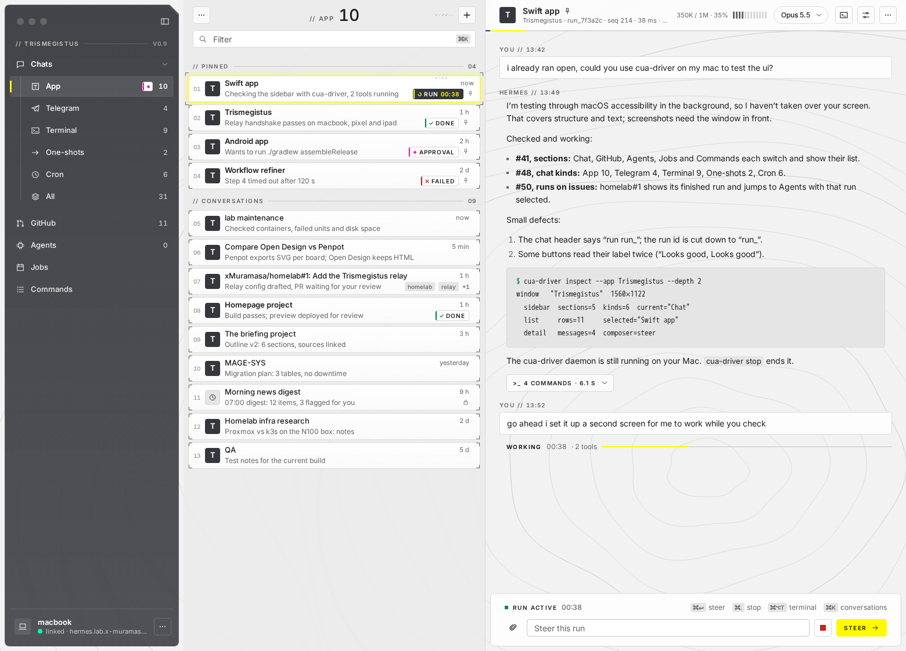
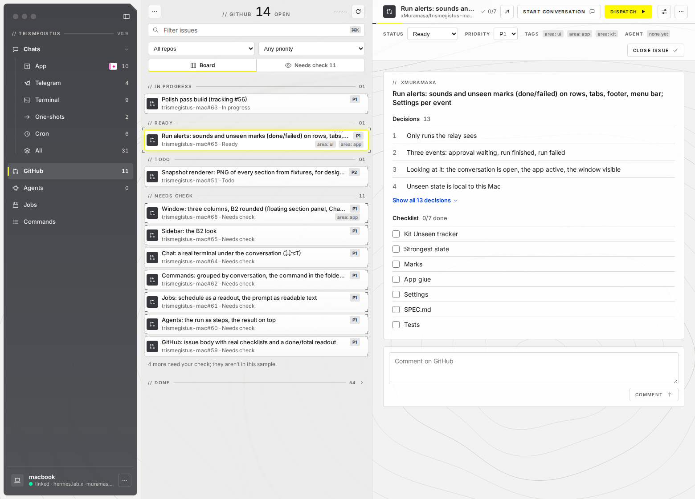

# trismegistus-mac

A native macOS companion for [Hermes Agent](https://hermes-agent.nousresearch.com) running on a home server: a menu
bar app for a glance and approvals, and a three-column window for long work. It talks to the relay in
[hermes-relay](https://github.com/xMuramasa/hermes-relay) over the same WebSocket protocol as the Android app
([trismegistus-android](https://github.com/xMuramasa/trismegistus-android)). SwiftUI, Swift 6 strict concurrency,
macOS 26. What it does and why: [SPEC.md](SPEC.md).

  
  

The window's design (the a3 skin), which the app has followed since #69. Penpot renders, with sample conversations.

## Highlights

- **Menu bar and window.** The menu bar glyph shows the connection and pending approvals; the popover lists sessions
  and opens a chat; the window has sections for Chats (app, Telegram, terminal, one-shot and cron runs), GitHub,
  Agents, Jobs and Commands, with a terminal drawer under the chat.
- **Live runs.** Tool progress as it happens, steer or stop a turn, retry or edit a prompt, thinking and effort
  controls, and a log of every command a run executed.
- **Approvals and alerts.** Once, This session or Deny from the banner or a notification. Runs that finish or fail
  while you look elsewhere mark their conversation and play a sound, through macOS notifications so Focus applies.
- **GitHub and agents.** The project board and issues, a needs-check inbox for work waiting on review, and background
  agent runs dispatched from an issue.
- **Search.** Across every conversation, plus find in the open one.
- **Safe defaults.** The device token lives in the login Keychain, never in preferences or logs; images are resized
  and stripped of EXIF before upload.

## How it's built

- **`TrismegistusKit`**: a Swift package with no dependencies beyond Foundation: protocol types, the relay client
  (WebSocket + REST), reconnect and replay, the state model. Its tests run on Linux too, in CI.
- **`TrismegistusUI`** and **`App/`**: the SwiftUI views (with snapshot tests) and the app target, generated with
  XcodeGen.
- **`protocol/`**: a copy of the relay's JSON Schema and example messages. Contract tests decode and round-trip every
  valid example and reject the invalid ones; a test fails when the copy is stale.
- **Design tokens**: colours, spacing, type and radii are generated from `design/tokens.json`, shared with the
  Android app, and `scripts/check-tokens.sh` fails on any raw value in a view.

Built and tested on a Mac over SSH from the home server (`scripts/mac-build.sh`, `scripts/mac-test.sh`); `scripts/`
has the rest. Status: in daily use on a MacBook (release `v2026.11.24`).
